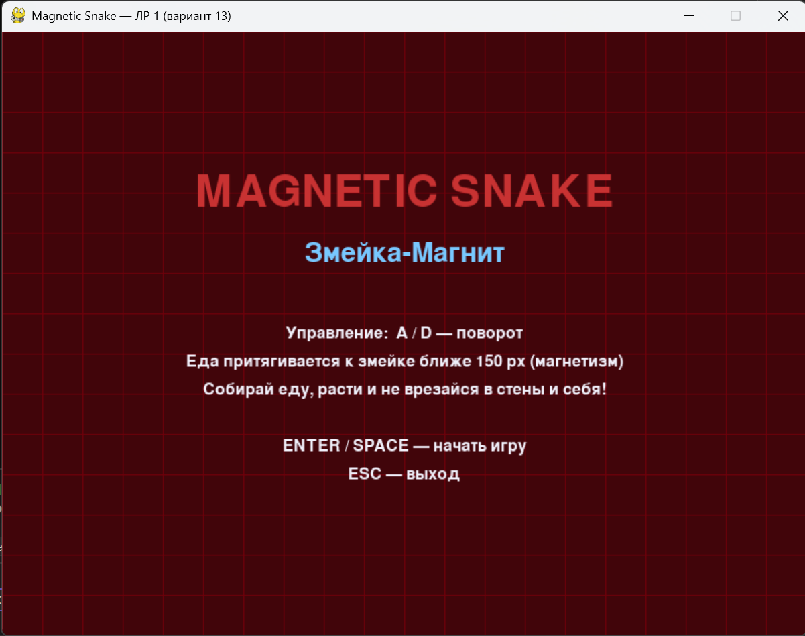
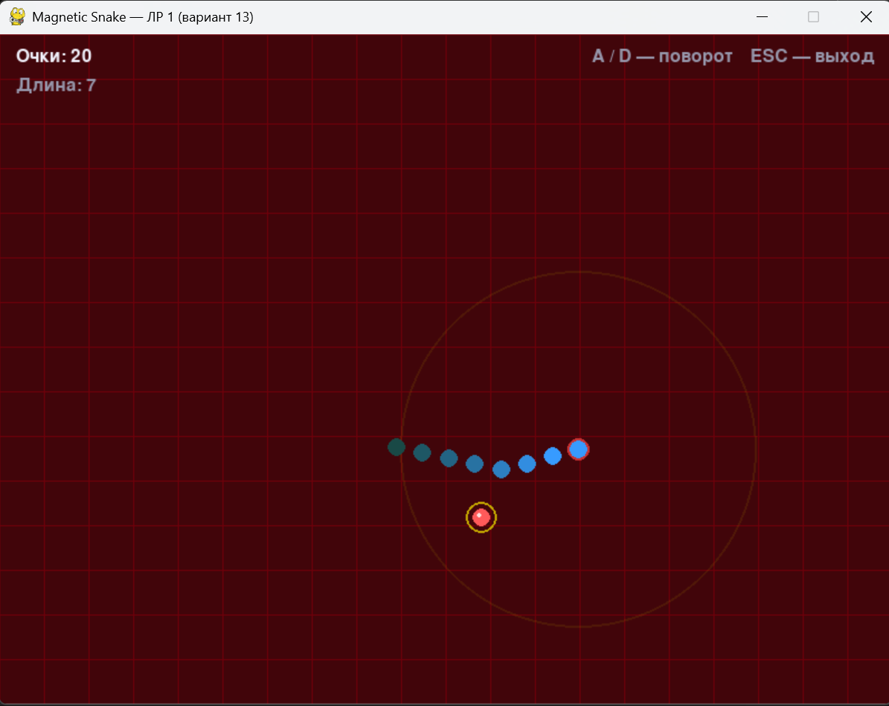
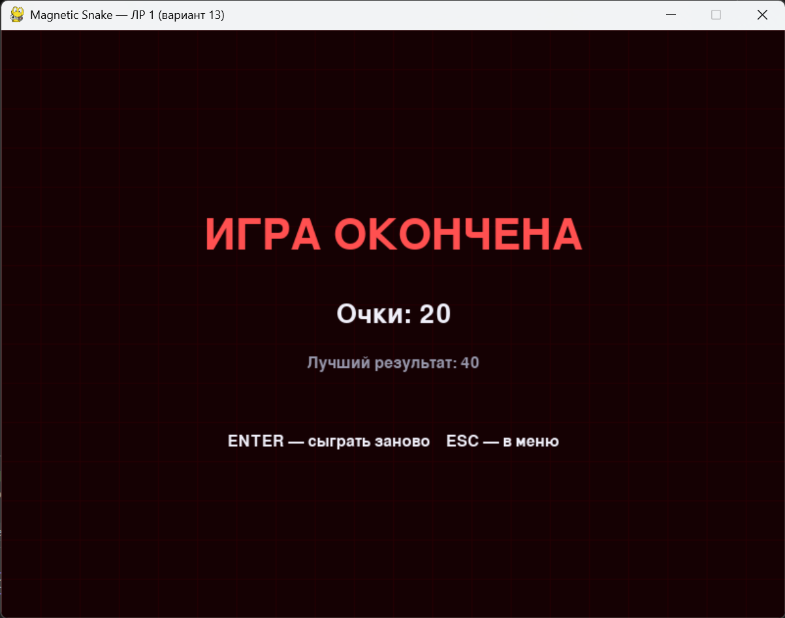

# Magnetic Snake — ЛР 1 (вариант 13)

2D-игра на Python + Pygame: змейка со свободной траекторией движения.
Еда дрейфует по экрану, а при приближении головы на расстояние
менее 150 пикселей — притягивается к ней (магнитное поле).

Дополнительно было реализовано внешнее хранение данных: 
настройки в JSON, логирование событий в TXT и таблица рекордов в CSV.

## Установка и запуск
1. Установите библиотеку Pygame:
   `pip install pygame`
2. Запустить игру:
   `python main.py`

## Управление
| Клавиша | Действие |
|---------|----------|
| A / ←   | поворот влево |
| D / →   | поворот вправо |
| SPACE / ENTER | начать игру / рестарт |
| ESC     | выход |

## Правила
1. Голова змейки движется под углом, который меняется клавишами A/D.
2. Тело — «история» позиций головы (свободная траектория).
3. Еда дрейфует по экрану.
4. Если еда ближе 150 px к голове — она притягивается с ускорением.
5. Съел еду → +10 очков, змейка растёт.
6. Врезался в стену или в собственный хвост → Game Over.

## Скриншоты




## Файлы данных
В проекте используются следующие внешние файлы для работы с данными:

1.  **`snake_settings.json`** — Конфигуратор физики. 
    *   *Назначение:* Хранит настройки скорости змейки, радиуса магнита и т.д. Позволяет менять баланс игры без переписывания кода.
    *   *Загрузка:* Осуществляется модулем `config_loader.py` с обработкой исключений (если файл удален или поврежден, игра не упадет, а загрузит настройки по умолчанию).
2.  **`snake_game.log`** — Файл логирования.
    *   *Назначение:* «Черный ящик» игры. Записывает каждое съедание еды и столкновение с указанием точного времени (timestamp). Настраивается в `logger.py`.
3.  **`snake_records.csv`** — Таблица рекордов.
    *   *Назначение:* Хранит результаты игроков (Имя, Очки, Дата). Используется модуль `score_manager.py` (считывает топ-5 при запуске и дописывает новые результаты при проигрыше).

## Структура проекта
*   `main.py` — точка входа (запуск игры).
*   `game.py` — основной игровой цикл и состояния (меню, игра, проигрыш).
*   `snake.py` — класс змейки (движение, коллизии).
*   `food.py` — класс еды (дрейф, магнетизм).
*   `constants.py` — статические константы.
*   **`config_loader.py`** — чтение JSON-настроек.
*   **`logger.py`** — настройка системы логирования.
*   **`score_manager.py`** — работа с CSV-таблицей рекордов.

## Формат JSON-настроек (пример)
```json
{
    "snake_speed": 4.0,
    "magnet_radius": 180,
    "magnet_accel": 0.8,
    "food_drift_speed": 1.5
}
